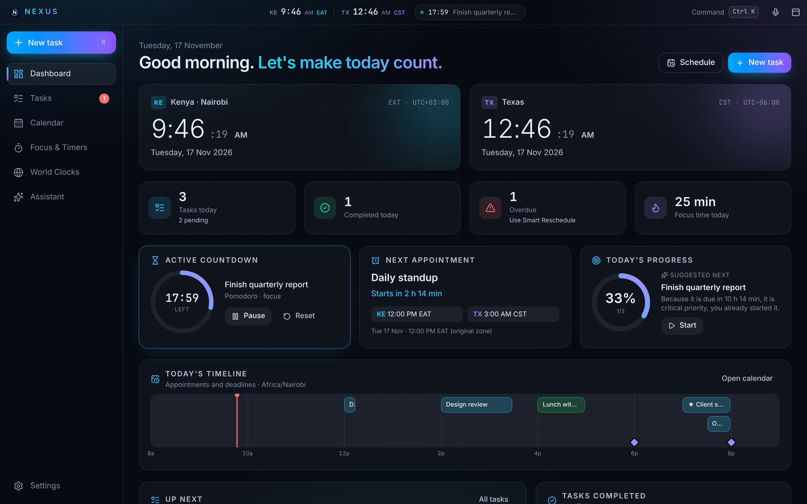
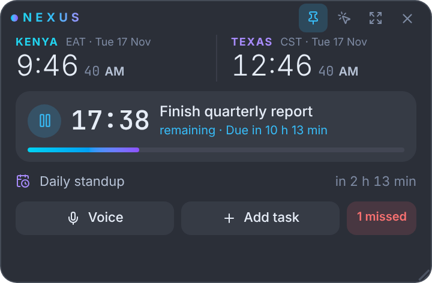
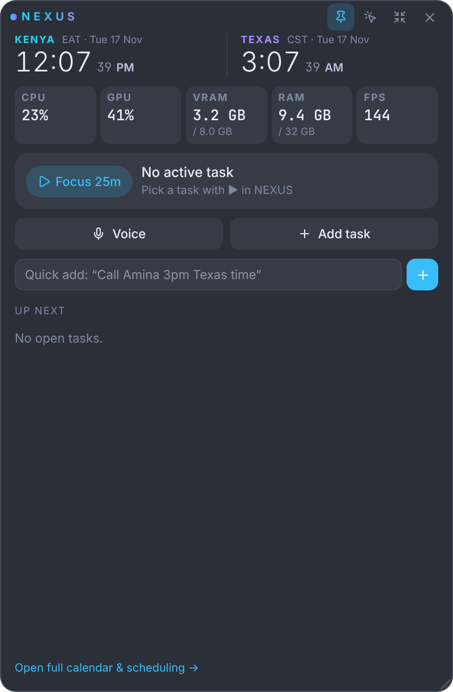

# NEXUS — AI Productivity & Time Command Center

NEXUS is a Windows 10/11 desktop app that combines tasks, scheduling, Kenya ⇄ Texas dual clocks, live countdowns, focus timers, reliable reminders, voice commands, and an **always-on-top floating overlay** that stays visible while you work in other apps.

**NEXUS · AI MAVERIX** — Powered by Digital Nomads 🇰🇪 🇺🇸

It is a real application: data is stored in a local SQLite database, reminders are delivered by a background scheduler (even with every window closed to the tray), and the optional AI assistant runs through the Rust backend so your API key never touches the UI.



| Floating overlay — Standard | Expanded | Mini |
|---|---|---|
|  |  |  |

<sub>Overlay screenshots use sample performance values from the browser preview; the desktop app shows your real CPU, GPU, VRAM, RAM and FPS.</sub>

More screens: [Calendar](docs/screenshots/calendar.png) · [Tasks](docs/screenshots/tasks.png) · [Focus](docs/screenshots/focus.png) · [World clocks](docs/screenshots/clocks.png) · [Voice/command preview](docs/screenshots/command.png) · [Light mode](docs/screenshots/dashboard-light.png)

---

## Contents

- [Features](#features)
- [Install (Windows)](#install-windows)
- [First five minutes](#first-five-minutes)
- [Keyboard shortcuts](#keyboard-shortcuts)
- [Voice commands](#voice-commands)
- [The floating overlay](#the-floating-overlay)
- [Reminders & background behaviour](#reminders--background-behaviour)
- [AI assistant (optional)](#ai-assistant-optional)
- [Data, backup & privacy](#data-backup--privacy)
- [Development setup](#development-setup)
- [Build & test commands](#build--test-commands)
- [Architecture](#architecture) (full details in [docs/ARCHITECTURE.md](docs/ARCHITECTURE.md))
- [Troubleshooting](#troubleshooting)
- [Known limitations](#known-limitations)

## Features

**Smart to-do list**: add, edit, delete (with Undo and a 30-day Trash) and complete tasks · priorities Critical/High/Medium/Low · deadlines with an explicit time zone · estimated duration · subtasks/checklists · notes · Work/Personal/Projects/Meetings plus custom categories · search and filters · drag to reorder (mouse or keyboard) · archive completed work · recurring tasks (the next instance is created when you complete one) · views: Today, Upcoming, This Week, Overdue, All, Completed, Archive, Trash, plus Calendar.

**Dual clocks, Kenya and Texas**: Kenya uses `Africa/Nairobi` (EAT, UTC+3, no DST). Texas uses `America/Chicago` (CST/CDT, DST handled automatically), switchable to El Paso/West Texas Mountain time. Clocks show time, seconds, date and weekday, in 12- or 24-hour format. There is also a converter, plus a 24-hour Kenya ⇄ Texas planner that highlights shared working hours.

> **El Paso note:** the IANA database has no `America/El_Paso` zone. El Paso is covered by **`America/Denver`** (MST/MDT), which NEXUS uses. `America/El_Paso` is accepted as an alias and automatically mapped.

**Countdowns and time tracking**: "Starts in 45 min", "Deadline in 2 h", "Overdue by 3 h", "In progress · 18 min left", with progress bars, deadline warnings and overdue badges · countdown, stopwatch and Pomodoro (focus / short break / long break), with start/pause/resume/reset/skip · time spent vs. estimate per task. All timers are computed from **persisted timestamps**, so they stay exact across sleep, hibernate, restarts and closing the app.

**Scheduling**: Day, Week and Month calendar · drag blocks to move them and drag the bottom edge to resize · drag appointments or task deadlines between days in Month view · click an empty slot to create · reserve time blocks for tasks · recurring appointments (move or delete one occurrence or the whole series) · double-booking detection with warnings · every appointment shown in Kenya and Texas time and **saved in its original time zone** · switch the calendar's display zone between Local, Kenya and Texas.

**Smart Reschedule**: for missed tasks and unfinished time blocks, NEXUS offers free future slots based on your working hours and existing calendar. It **never moves anything automatically**, and important appointments always need explicit confirmation.

**Reminders**: at time, 5/15/30/60 minutes before, or custom offsets · Windows toast notifications plus an optional chime · snooze for 5/10/30 minutes · delivered while minimized to the tray.

**Automatic work clock**: the clock starts by itself when you use the computer, pauses after **1 minute** (configurable) without keyboard or mouse input in any app, and resumes when you are back. The pause is backdated to your last input and the resume to your first, so idle time is never counted. Time while the PC is **locked, asleep or suspended**, and time while NEXUS is not running, is never counted either, and the day's total survives restarts. Use **Break** for a manual pause; **Clock out** stops tracking until the next day (or until you clock in again). Focus timers pause after 5 minutes idle or as soon as the PC locks or sleeps. Automatic tracking can be turned off in *Settings → Work clock & inactivity*.

**Auto-placement**: *Auto-plan* (Dashboard, Tasks, Calendar) fits your open tasks into **free working time** (your working hours and days, around existing appointments, with a buffer). It places the earliest deadline first, then by priority; it subtracts time already tracked, splits long tasks into blocks, never leaves tiny leftover blocks, and flags anything that would finish after its deadline. You get a preview and choose what to apply. New tasks that have an estimate are placed automatically, with an **Undo** button; this can be turned off in Settings. Existing appointments are never moved.

**Insights** (main app): clocked hours, focus minutes and completions per day · on-time rate · estimate accuracy (actual vs. estimated time) · your most productive hours and weekdays · focus by category · idle time excluded · completion streak · written findings such as "Tasks take ~47% longer than you estimate". Ranges are 7, 30 or 90 days, with optional coaching from Claude.

**History** (main app): a searchable, filterable timeline of everything done, including completed tasks (on time or late, time tracked), focus sessions, clock-ins and outs, auto-pauses and resumes, schedule changes and auto-planning. You can reopen completed tasks from it. Existing completed tasks and focus sessions were imported when upgrading.

**Dashboard**: tasks today, completed, pending and overdue · next appointment with countdown · active timer · focus time today · progress ring · 7-day completion and focus-minute charts · a timeline of today's appointments and deadlines · up-next list · missed items.

**Voice and natural language**: a microphone button and global shortcut capture **one command at a time** (never continuous recording), with keyboard input always available. Commands become structured actions. Destructive or ambiguous actions, and anything created by voice, show the recognized text and a preview first.

**AI assistant (optional)**: a summary of your day, what to do next, free slots, conflicts, project breakdown into subtasks, realistic time estimates, and reorganizing overdue work. All of this **works offline** with local heuristics; Claude can enhance it if you add an API key.

**Floating overlay**: always-on-top, draggable, resizable, adjustable opacity, pin/unpin, Mini/Standard/Expanded modes, **live CPU / GPU / VRAM / RAM / FPS and a temperature gauge** (like Xbox Game Bar), a **✓ button to complete the active task in every mode** (and checkboxes on every task in Expanded, plus a "Done today" list), work-clock controls, optional click-through with a global shortcut to disable it (or switch the feature off entirely), and it remembers its position and size per mode across monitors. See [below](#the-floating-overlay).

**Auto Typer**: types your text into any other app with a human rhythm: varied key holds and gaps, bursts, pauses, typos that get corrected and later revisions, ending with exactly your text. Formatting (`**bold**`, `*italic*`, `# headings`, or rich text pasted from Word / Google Docs) is typed as real formatting, never as symbols. See [below](#auto-typer).

**System monitor**: live CPU, RAM (percentage plus used / total), GPU, VRAM and temperature with an animated graph, on the dashboard and in the overlay. Both read the same sample, so they always agree.

## Install (Windows)

1. Download the latest **`NEXUS_x.y.z_x64-setup.exe`** (NSIS, recommended) or **`.msi`** from the repository's GitHub **Releases** page, or from the **Actions → CI & Windows installer → Artifacts** of any build.
2. Run it. The NSIS installer installs per-user (no admin prompt). It bootstraps Microsoft Edge WebView2 if it's missing (it's preinstalled on Windows 10 21H2+ and Windows 11).
3. Start **NEXUS** from the Start menu.

The installers are currently **unsigned**, so Windows SmartScreen may say "Windows protected your PC". Click **More info → Run anyway**. Code signing can be added later (see Troubleshooting).

## First five minutes

1. Open NEXUS. Kenya and Texas time are live at the top of the dashboard and in the title bar.
2. Press **N** to add a task. Give it a deadline; the picker shows the equivalent Kenya and Texas time.
3. Schedule it: in the task editor, use **Schedule time block**, or press **E** for an appointment.
4. Press **▶** on the task to make it active, then start a focus session (dashboard or **Focus & Timers**).
5. Press **Ctrl+Shift+Space** to show the floating overlay, then keep working in any other app.
6. If you miss it, use **Reschedule** (Smart Reschedule) on the dashboard or the task.
7. Close the window. NEXUS keeps running in the tray, and everything is already saved.

A "Getting started" checklist on the dashboard tracks these steps for you.

## Keyboard shortcuts

**Global** (work anywhere in Windows; configurable in *Settings → Global keyboard shortcuts*):

| Shortcut | Action |
|---|---|
| `Ctrl+Shift+Space` | Show / hide the floating overlay |
| `Ctrl+Shift+X` | Toggle overlay click-through (use this to get the mouse back) |
| `Ctrl+Shift+N` | Quick add task |
| `Ctrl+Shift+V` | Voice command |
| `Ctrl+Shift+H` | Show the NEXUS window |
| `F6` | Start / stop the Auto Typer (only claimed while the Auto Typer screen is open) |
| `Esc` | Stop the Auto Typer while it is typing |

**In the app:**

| Key | Action |
|---|---|
| `Ctrl+K` | Command center (type or speak) |
| `N` / `Ctrl+N` | New task |
| `E` | New appointment |
| `V` | Voice command |
| `/` | Search tasks |
| `1`–`8` | Dashboard, Tasks, Calendar, Focus, Clocks, Assistant, Insights, History |
| `,` | Settings |
| `Esc` | Close dialog |
| Calendar: `←` / `→`, `T`, `D` / `W` / `M` | Previous/next, today, day/week/month |
| Task list: focus the drag handle, `Space`, arrow keys | Reorder by keyboard |

## Voice commands

Speak (microphone button, `V`, or `Ctrl+Shift+V`) or type in the command center (`Ctrl+K`). Examples:

- "Add a task to finish my report tomorrow at 9 AM"
- "Remind me to attend the meeting at 4 PM Kenya time"
- "Move my meeting to Friday at 3 PM Texas time" (for a recurring meeting, only the next occurrence moves)
- "What tasks do I have today?" · "Show my upcoming appointments" · "What's overdue?"
- "Start a 25-minute focus session" · "Start a timer for 10 minutes" · "Pause the timer" · "How much time is left?"
- "Mark my current task as complete" · "Delete the grocery task" (always confirmed, and restorable)
- "Schedule a call with Amina on Thursday from 2 to 3 PM Kenya time"
- "Show the overlay" · "What should I work on next?" · "Summarize my day"

**Time zones you can say:** *Kenya time, Nairobi time, EAT* · *Texas time, Central time, CST/CDT* · *El Paso time, Mountain time, MST/MDT* · *my time / local time*. Without one, your home zone (*Settings → Time zones*) is used.

**Speech engines** (*Settings → Voice input*): **Windows speech recognition**, the native WinRT recognizer, needs *Settings → Privacy & security → Speech → Online speech recognition* turned on. That Windows switch is your consent for Microsoft's speech service. A **WebView speech API** option is used if the runtime provides one. **Keyboard only** is always available.

## The floating overlay

Toggle it with `Ctrl+Shift+Space`, the **Overlay switch at the bottom of the sidebar**, the title-bar button, *Settings → Floating overlay → Show the floating overlay*, or the tray menu. Closing the overlay with its ✕ only hides it: NEXUS, reminders and timers keep running, and any of those controls brings it straight back.

- **Modes**: *Mini* shows the active task and countdown. *Standard* adds both clocks, progress, the next event, and voice/add buttons. *Expanded* adds quick add, a compact task list you can tick off, voice commands, and your schedule. Double-click the header, or use the expand button, to cycle modes.
- **Move** it by dragging the header. **Resize** it with the bottom-right grip. Size is remembered **per mode** and position across restarts.
- **Pin** keeps it on top; unpin to let other windows cover it. Set **opacity** in Settings.
- **Performance stats**: CPU, GPU, VRAM (used / total), RAM (**percentage** plus used / total) and FPS appear in every mode, updated once a second. Values at 90% or more turn amber. Turn them off with *Settings → Floating overlay → Show system performance*. Sampling only runs while the overlay is visible.
  - **CPU**: whole-system usage from the `% Processor Utility` counter, the figure Task Manager shows on Windows 10/11 (falling back to processor busy time where that counter is missing). The overlay and the dashboard share one reading per second, so they never disagree.
  - **CPU colour**: green below 60%, yellow from 60%, red from 80% (changeable in *Settings → Floating overlay*). The figure, the dashboard tile and every part of the CPU graph take the colour of their level, so the graph's history shows when usage was up. A value hovering at a threshold does not flicker: it has to drop 3 points below before the colour steps back.
  - **RAM**: memory in use as a percentage of installed memory, with used / total underneath.
  - **Live graph**: press the graph button in the overlay header, or click any stat, for an animated graph of that metric over the last minute (Standard and Expanded modes). Switch metric with the tabs above the graph or by clicking another stat; click the graphed stat again to close it. One graph is shown at a time. The line glides between one-second samples using a transform-only animation, so it adds no measurable load.
  - **GPU / VRAM**: the GPU with the most dedicated memory, read from the same Windows performance counters Task Manager uses (NVIDIA, AMD and Intel; Windows 10 1709+). GPU % is the busiest engine (3D, copy, video…), matching Task Manager.
  - **FPS**: the frame rate of the app in the foreground (or the busiest app drawing frames if NEXUS itself is focused), measured by counting DirectX 9–12 present calls, as PresentMon and Game Bar do. Hover the value to see which app it belongs to. Vulkan/OpenGL titles that don't present through DirectX show "—".
  - **FPS permission (one-time):** Windows only lets administrators or members of the **Performance Log Users** group read these events. Without it, FPS shows a 🔒. To fix it without running NEXUS as admin, open **Terminal (Admin)**, run the command below, then **sign out and back in**:

    ```bat
    net localgroup "Performance Log Users" "%USERNAME%" /add
    ```

    Alternatively, turn FPS off in Settings and keep the other stats.
- **Temperature gauge**: GPU temperature comes from the graphics driver's adapter performance data (the value Task Manager shows), which works on most modern NVIDIA, AMD and Intel GPUs. **CPU temperature** is read from the sensors Windows exposes (ACPI thermal zones). Many PCs only expose these to administrators, or not at all, so CPU may show "—"; hover the tile for details. The gauge turns amber at 70 °C and red at 85 °C. You can choose °C or °F in Settings.
- **Complete tasks from the overlay**: the green ✓ next to the active task completes it, with Undo. In Expanded mode every task has a checkbox and "Done today" lists what you finished.
- **Work clock**: the Standard and Expanded modes show clock in/out, break/resume and the session timer, and Mini shows the session time.
- **Click-through** lets mouse clicks pass to the app underneath. Press **`Ctrl+Shift+X`** (configurable) to turn it off again; the tray menu and *Settings → Floating overlay → Click-through is on* also switch it. To **disable click-through completely** (so it can never get turned on by accident), switch off *Settings → Floating overlay → Allow click-through*; the overlay button, global shortcut and tray option then do nothing.
- **Multi-monitor**: if the monitor it was on is disconnected, or the resolution changes, the overlay is moved back onto a visible screen (top-right of the primary monitor).
- **Performance**: it renders once per second and stops completely while hidden. Animations are minimal, with no video or polling, to avoid affecting games, calls or remote desktop.
- **Limits** (by design): it won't draw over **exclusive-fullscreen** games (use borderless/windowed mode), the lock screen, UAC prompts, or DRM-protected content. NEXUS deliberately doesn't try to bypass these OS security boundaries.

## Smart scheduling

Press **AI Schedule** in the Dashboard header (also on the Calendar) to open a compact panel, then type or dictate what you need:

> Repairing Mineh's phone today, in around 3 hours, preferably in the evening Kenya time.

NEXUS reads the task ("Repair Mineh's Phone"), the day (today), the length (about 3 hours), the preferred part of the day (evening) and the zone (Africa/Nairobi), checks the calendar, schedules it in a free slot and replies with the start, end and zone (and the Texas equivalent). It is in the To-Do list and on the calendar at once. Everything runs on your PC; no AI service is involved.

**It is a conversation.** NEXUS remembers what you have been talking about and matches references against your saved calendar:

> **You:** Schedule my gym session tomorrow at 6 PM Kenya time for one hour.
> **NEXUS:** Scheduled: Gym Session — Tomorrow 6:00 PM – 7:00 PM EAT
> **You:** I also need to finish reviewing my financial report. Schedule it before the time I'm going to the gym.
> **NEXUS:** Scheduled: Review Financial Report — Tomorrow 9:00 AM – 10:00 AM EAT · before Gym Session (tomorrow 6 PM) · No length given: 60 minutes assumed.

- **Several activities in one message**: "Tomorrow I need to review my financial report for two hours, attend a Zoom meeting at 3 PM, and go to the gym at 6 PM. Schedule the report before my meeting." creates three entries, the meeting as a fixed appointment, the report before it.
- **Before / after are real constraints**: the chosen times must satisfy them, including chains (C after B, B after A). If an arrangement is impossible NEXUS says why and offers the nearest free times; nothing is created until you choose.
- **Changing things**: "Move that task to after my meeting", "Move the first task to tomorrow", "Give me 30 minutes between those two activities", "Make the Zoom meeting fixed", "Reschedule everything except my interview", "Put the phone repair task before my evening appointment", "Schedule the remaining work after lunch".
- **Never invents anything**: if "my dentist appointment" is not on the calendar it says so and schedules nothing against it; if "my meeting" could be two meetings it asks which.
- **No duplicates**: referring to a task that is already in the To-Do list gives that task a time (using its saved estimate) instead of adding it again.
- **Voice**: the microphone button dictates one instruction at a time into the text box, where you can check and edit it before sending. The microphone is off again as soon as that instruction ends, you press stop, or the panel closes. It uses the speech engine chosen under *Settings → Voice input*.
- The panel is closed by default; minimising it (the – button or Esc) keeps the conversation and any unsent text, also across restarts.

- **Writes the title for you.** The activity becomes a short, action-style title and the scheduling details stay out of it: "Repairing Mineh's phone today, for around 3 hours…" → **Repair Mineh's Phone**; "I need to finish my financial report tomorrow morning" → **Complete Financial Report**; "Schedule a Zoom interview with James on Friday at 4 PM" → **Zoom Interview with James**. Names and acronyms are kept as written. Click an entry in the reply to open and rename it, or edit the task later; the request as you typed it is saved in the task's notes.
- **Understands**: today / tomorrow / "next Friday" / "this weekend" / dates · morning, afternoon, evening, "later tonight" · lengths ("about 2 hours", "1h30", "half an hour") · exact times ("at 3pm", "3:00 PM to 4:00 PM") and approximate ones ("around 4", "in two hours") · deadlines ("by Friday 5pm", "before my next meeting") · "Kenya time" / "Texas time".
- **Asks instead of guessing** when two readings would give different schedules: "today, in 3 hours" (how long, or how soon?), "at 9" (morning or evening?), "next Friday" said early in the week.
- **Never double-books.** Everything already on the calendar is unavailable, with the scheduling buffer around it. If nothing is free where you asked, it offers the closest alternatives to pick from and creates nothing until you choose.

**Fixed appointments and flexible tasks.** Every calendar entry is one or the other (appointment editor → *Scheduling type*):

| | Fixed appointment 🔒 | Flexible task |
|---|---|---|
| For | Meetings, calls, interviews, classes | Time reserved to work on a task |
| Moved automatically | Never | Yes, if not completed or if a fixed appointment needs its time |
| Its time | Blocked for everything else | Blocked until it is moved |
| In the calendar | Solid, with a lock | Dashed outline |

Appointments you create are fixed unless they are a block for a task; a request with a set time for a meeting, call, interview and similar is made fixed automatically.

**Unfinished tasks are re-planned, never completed for you.** Only you mark a task complete. When a flexible block's time passes with its task still open, NEXUS moves the block to the next suitable free time: critical and high priority first, then the nearest deadline, inside your working hours or the part of the day you originally asked for. The block is moved (not duplicated), marked *Auto-rescheduled* in the calendar and To-Do list with its previous times, recorded in History, and you get a notification with Undo. If the only free time is after the task's deadline, or the block has already been moved four times, NEXUS stops and asks you, proposing a time. This check runs every minute, at start-up and when you return from sleep or lock.

Everything is configurable under *Settings → Smart Scheduling*: on/off, auto-rescheduling, protection of fixed appointments, notifications, the default time zone, the buffer, working hours, and what morning / afternoon / evening mean.

**One schedule everywhere.** The Dashboard, To-Do list, Calendar and the floating overlay all read the same stored tasks and calendar entries. Time reserved for a task follows the task: deleting the task takes its time off the calendar and out of the overlay's Schedule; restoring it from the Trash brings back time that is still ahead; completing it clears time that has not started (reopening restores it); renaming either one renames the other; emptying the Trash removes it for good. Deleting a repeating task asks whether to remove only this occurrence (the next one is scheduled) or the whole series.

The overlay's **Schedule** section (Expanded mode) lists what is under way, coming up and overdue in time order, with the start time and the time remaining, a lock for fixed appointments, and a note when nothing is scheduled.

## Completing tasks

Marking a task complete always asks first: *Are you sure you want to mark "Repair Mineh's Phone" as completed?* with **Confirm Completion** and **Cancel**. This is the same in the To-Do list, the Dashboard, the Calendar and the floating overlay; voice and typed commands show what they will do and wait for confirmation too. Cancel changes nothing. After confirming, the completion time is recorded, every view updates, and the notification offers **Undo**. NEXUS never completes a task by itself.

## Dashboard

The two clocks sit with **Next appointment** and **Today's progress** as one scheduling overview. Below them are the work clock, the active countdown and four numbers, each of which opens its details when clicked:

| Card | Opens |
|---|---|
| Tasks today | Today's tasks (due today, in progress, or with time reserved today) with time, priority and status; open, edit or complete each one |
| Completed today | What you completed today and when, with **Restore** for anything completed by mistake |
| Overdue | Open tasks past their deadline, the original deadline, priority and whether time is reserved; **Reschedule** opens Smart Reschedule |
| Focus time today | Today's total and each focus session with its duration and task |

## Tasks on the calendar

Every To-Do task with a due date appears on the calendar on that day, in Day, Week and Month views (Month shows the first few and a "+N more" link that opens the day). The calendar and the To-Do list are two views of the same data, so a change in one shows in the other at once.

- **Click** a task to open it (details, edit, due date). **Tick** its circle to complete or reopen it. **Drag** it to another day to reschedule; the time of day is kept.
- Pending tasks carry their priority colour, **high-priority** ones a flag, **overdue** ones are red with a warning mark, and **completed** ones are greyed and struck through.
- Tasks without a date are not on the calendar; they stay in the To-Do list, and the calendar says how many there are.

## Auto Typer

Open **Auto Typer** in the sidebar (or press `9`).

1. Type or paste your text. `**bold**`, `*italic*` (also `__bold__`, `_italic_`) and `# headings` are shown styled with the markers greyed out. Formatted text pasted from Word, Google Docs or a web page keeps its bold, italic and headings. **Ctrl+B / Ctrl+I** wrap the selection.
2. Press **Start** (or `F6` from any app while the Auto Typer screen is open), then click into the text box you want during the countdown. NEXUS never types into its own windows: if it is still in front, it waits for you.
3. Press `F6` or `Esc` to stop. Every key is released, and Caps Lock (switched off for the run) is restored.

| Setting | What it does |
|---|---|
| Speed, Mistakes, Pauses | Raw keying speed, share of keys that get a typo (always corrected), and how long the pauses and breaks are |
| Technique | Touch typing (keys overlap when fast), two-finger or one-handed |
| Formatting | *Apply bold / italic* presses Ctrl+B / Ctrl+I around marked text (Word, Google Docs); *Drop markers* types plain text; *Type exactly as written* types the symbols |
| Lock onto the text box | Ignores mouse clicks while typing so a click can't move the cursor, and pauses if the window changes, carrying on when you return. Stop with `F6` or `Esc` |
| Revise with arrow keys and Delete | Off limits corrections to Backspace, for apps with autocomplete |
| US keyboard layout | Holds Shift for symbols; turn off on other layouts |

**Return to Dashboard After Inactivity** (*Settings → Auto Typer*, on by default): if the Auto Typer screen is left open with no keyboard or mouse activity anywhere for 5 minutes (configurable), NEXUS goes back to the Dashboard. It never happens while the Auto Typer is typing, and your text and settings are kept.

The target should be a plain text field: autocorrect, auto-indent or auto-closing brackets in the other app can throw corrections off. Apps running as administrator only accept the keystrokes if NEXUS runs as administrator too.

## Reminders & background behaviour

- Reminders are scheduled into SQLite and delivered by a **background thread in the NEXUS process**. It keeps running while all windows are hidden in the tray, which is why closing the window minimizes to the tray by default.
- To keep reminders working after a reboot, enable **Settings → Startup → Launch NEXUS when Windows starts**. It registers a per-user startup entry and starts NEXUS in the tray (`--minimized`).
- **Sleep and resume**: the scheduler compares wall-clock time against stored fire times, so anything that came due during sleep fires within about 15 seconds of waking. Reminders more than 12 hours stale (e.g. the PC was off overnight) produce a single "missed" summary instead of a burst of notifications.
- Recurring appointments always have reminders queued for the next two weeks, refreshed hourly and after every change.
- Snooze from the in-app toast (5/10/30 minutes) or use the default snooze length from Settings.

## AI assistant (optional)

NEXUS is fully functional without AI. To enable Claude:

1. *Settings → AI assistant* → turn on **Enable** and **Consent**.
2. Paste an Anthropic API key and press **Save key**. It's stored in **Windows Credential Manager** (via the Rust `keyring` crate) and can't be read back by the UI.
3. Use the Assistant page, **Break down** in the task editor, or "Ask Claude to interpret" for unrecognized commands.

Only task/appointment titles, times, priorities and working hours are sent, and only when you trigger an AI action. Notes are not sent. Requests use model `claude-opus-5-5` by default (changeable in Settings), with structured JSON output for subtask breakdowns. AI suggestions are never applied without your click.

## Data, backup & privacy

- **Where:** `%APPDATA%\com.nexus.productivity\nexus.db` (SQLite, WAL mode). Settings show the exact path.
- **Automatic backups:** a daily rolling backup (newest 7 kept) in `…\backups\`, plus a full copy **before every schema migration, restore and import**.
- **Manual:** *Settings → Data*: **Back up database…** (`.db`), **Export JSON…** (portable, human-readable), **Restore backup…**, **Import JSON…**. Restore and import first save your current data, so they can be undone.
- **Never in Git:** `.gitignore` excludes `*.db`, WAL/SHM files, backups, `.env` files and keys. No personal data, credentials or secrets belong in the repository.
- Nothing leaves your PC except optional AI requests you trigger, and Windows' own speech service if you use native dictation.

## Development setup

Prerequisites:

- **Node.js 22+** and npm
- **Rust (stable)** via [rustup](https://rustup.rs)
- **Windows:** Microsoft C++ Build Tools ("Desktop development with C++") and WebView2 (preinstalled on Windows 11). See the [Tauri prerequisites](https://v2.tauri.app/start/prerequisites/).
- **Linux (for development/CI only):** `libwebkit2gtk-4.1-dev libgtk-3-dev libayatana-appindicator3-dev librsvg2-dev libsoup-3.0-dev libxdo-dev`

```bash
git clone <your-repo-url> nexus
```

```bash
cd nexus
```

```bash
npm install
```

```bash
npm run app:dev
```

`npm run app:dev` starts Vite on port 1420 and opens the desktop app with hot reload. `npm run dev` alone serves the UI in a normal browser for fast UI work. In that mode data lives in `localStorage` and native features (overlay, tray, SQLite, global shortcuts) are stubbed. Add `?window=overlay` to the URL to preview the overlay.

## Build & test commands

| Command | What it does |
|---|---|
| `npm test` | Vitest unit/integration tests (time zones & DST, countdowns, recurrence, conflicts, Smart Reschedule, reminders, voice parsing, store CRUD/persistence, overlay geometry) |
| `npm run test:rust` | Rust tests for the persistence core (migrations, CRUD, reopen-from-disk, reminders queue, backup/restore, import/export) |
| `npm run typecheck` | TypeScript strict type check |
| `npm run test:all` | All of the above |
| `npm run build` | Production web build into `dist/` |
| `npm run app:build` | **Windows installer**: `src-tauri/target/release/bundle/nsis/*.exe` and `bundle/msi/*.msi` (run on Windows) |

**Reproducible installer builds:** [`.github/workflows/ci.yml`](.github/workflows/ci.yml) runs the tests on Ubuntu, then builds the NSIS and MSI installers on `windows-latest` and uploads them as artifacts. Push a tag like `v1.0.0` and the installers are attached to a **draft GitHub Release** as well.

## Architecture

```
┌──────────────────────── NEXUS.exe (one process) ────────────────────────┐
│  WebView2 "main" window          WebView2 "overlay" window (transparent,│
│  React + TS + Tailwind           always-on-top, click-through capable)  │
│        │  invoke / events                │                              │
│  ──────┴─────────────── Tauri 2 IPC ─────┴───────────────────────────── │
│  Rust shell (src-tauri/src): commands · tray · global shortcuts ·       │
│  overlay control · autostart · single-instance · window-state ·         │
│  reminder scheduler thread → Windows toasts · AI proxy (keyring) ·      │
│  WinRT speech                                                           │
│        │                                                                │
│  nexus-core crate (src-tauri/core): SQLite schema, migrations,          │
│  repositories, reminder queue, backup/restore/export                    │
└─────────────────────────────── %APPDATA%\…\nexus.db ────────────────────┘
```

Time-zone math, recurrence, countdowns, scheduling, voice parsing and assistant heuristics are pure TypeScript modules in `src/lib/`, covered by unit tests. See **[docs/ARCHITECTURE.md](docs/ARCHITECTURE.md)** for the module map, data flow, **database schema** and **migration strategy**.

```
src/
  data/        types (domain model) + backends (Tauri IPC / localStorage)
  store/       zustand app store (all mutations auto-save) + UI state
  lib/         time, countdown, recurrence, schedule, reminders, assistant,
               stats, overlayGeometry, perf, typer/{engine,controller},
               voice/{parser,execute,engine}, platform
  components/  UI kit, editors, command center, charts, shell
  views/       Dashboard, Tasks, Calendar, Focus, Clocks, Assistant, Typer, Settings
  overlay/     floating overlay app
src-tauri/
  core/        nexus-core: SQLite persistence, typer playback loop, perf maths (+ tests)
  src/         Tauri shell: commands, overlay, shortcuts, scheduler, ai, speech,
               perf, typer, win_input, win_cpu
```

## Troubleshooting

| Problem | Fix |
|---|---|
| **No notifications** | Windows Settings → System → Notifications: make sure notifications are on for NEXUS and Focus Assist / Do Not Disturb isn't hiding them. Use *Settings → Send test notification*. |
| **Reminders stop after restart** | Enable *Launch NEXUS when Windows starts*. Reminders need NEXUS running (in the tray is fine). |
| **Overlay is invisible over a game** | The game is in exclusive fullscreen. Switch it to borderless/windowed fullscreen. |
| **Can't click through to my app / can't click the overlay** | Press `Ctrl+Shift+X` (or use the tray menu → *Overlay click-through*). |
| **FPS shows a 🔒** | Windows blocks the frame-rate events for normal users. Add yourself to *Performance Log Users* (see [The floating overlay](#the-floating-overlay)) and sign out/in, or turn FPS off. |
| **FPS shows "—" in a game** | Nothing is drawing frames, or the game uses Vulkan/OpenGL without DirectX presentation. CPU/GPU/RAM still work. |
| **CPU temperature shows "—"** | Your PC's firmware doesn't expose CPU temperature to Windows for normal users. Running NEXUS as administrator may help on some PCs; GPU temperature still works. |
| **Work clock paused while I was reading** | No keyboard/mouse input for the idle limit (1 minute by default) counts as inactivity; it resumes on your next key press or mouse move. Raise *Settings → Work clock & inactivity → Pause after* if you want a longer limit. |
| **GPU / VRAM show "—"** | Your graphics driver doesn't expose GPU performance counters (very old drivers, some virtual machines or remote sessions). Update the GPU driver. |
| **Overlay is off-screen** | Press `Ctrl+Shift+Space` twice. It's moved back onto a connected monitor when shown. |
| **A global shortcut does nothing** | Another app owns that combination. Settings flags it; pick a different one. |
| **Voice: "privacy policy was not accepted"** | Windows Settings → Privacy & security → Speech → turn on *Online speech recognition*. Or type the command. |
| **Voice: "no speech language pack"** | Windows Settings → Time & language → Speech → add a language (e.g. English (United States)). |
| **Microphone blocked** | Windows Settings → Privacy & security → Microphone → allow desktop apps. |
| **SmartScreen warning when installing** | The installer isn't code-signed yet: *More info → Run anyway*. To sign, add a certificate per [Tauri's Windows signing guide](https://v2.tauri.app/distribute/sign/windows/). |
| **"Created by a newer version of NEXUS"** | You opened a newer database with an older build. Update NEXUS; your data was not modified. |
| **Something went wrong after a restore/import** | The previous data was saved as `backups\nexus-before-restore-*.db` / `nexus-before-import-*.db`. Restore that file. |
| **App won't start / blank window** | Make sure WebView2 is installed ([download](https://developer.microsoft.com/microsoft-edge/webview2/)). Your data is untouched. |
| **AI requests fail** | Check the key in *Settings → AI*, consent is on, and you're online. Everything else keeps working offline. |

## Known limitations

- Native speech uses Windows' online dictation service. Fully offline speech-to-text (e.g. a bundled Whisper model) isn't included yet; the engine abstraction in `src/lib/voice/engine.ts` and `src-tauri/src/speech.rs` is the place to add one.
- Snooze buttons are on the in-app toast; Windows toast action buttons aren't used.
- The overlay intentionally doesn't draw over exclusive-fullscreen apps, the secure desktop, or protected content.
